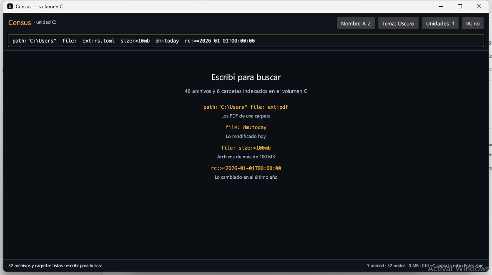
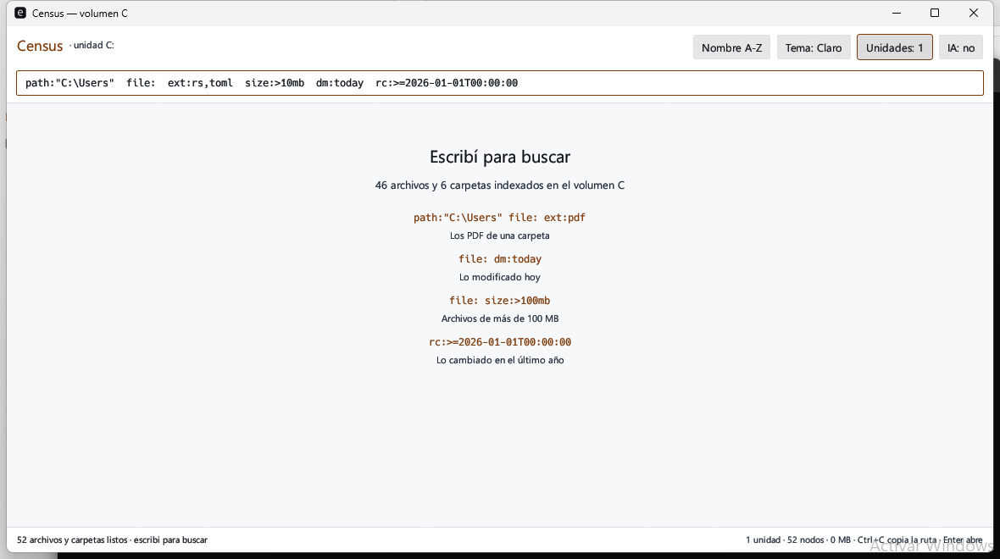
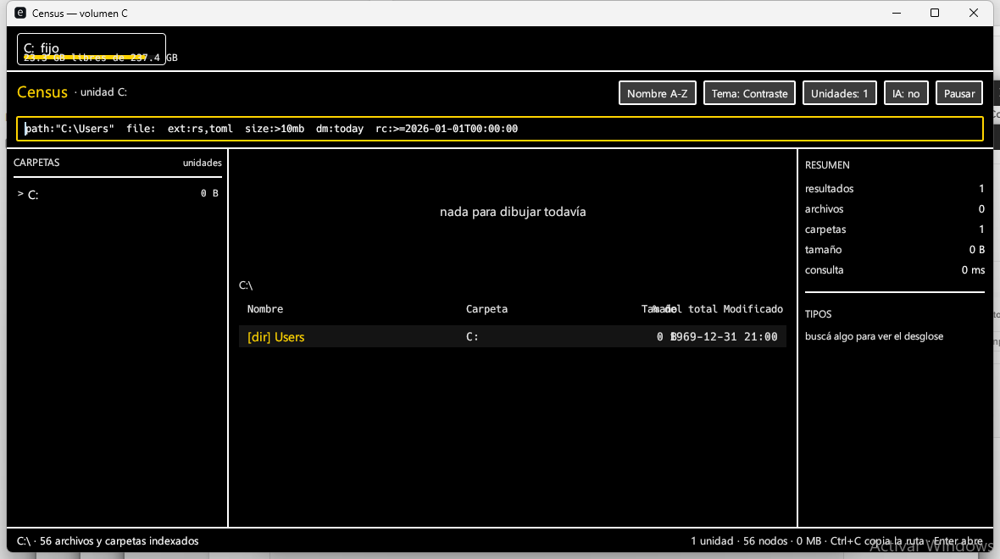

# Census


Indexador de archivos para Windows (y versiones macOS/Linux en desarrollo): lee la MFT
del volumen NTFS en bloque, una sola vez, y contesta consultas sobre millones de
archivos en milisegundos. Expuesto con una API
mínima pensada para que otras apps (SortEverything, WizEverything) lo usen como base de
datos, con un servidor MCP para que lo use una IA y con una ventana propia.

Un censo enumera a todos los habitantes de un territorio; Census enumera a todos los
archivos de tus unidades, y responde antes de que termines de escribir.

## Cómo funciona en cada plataforma

Census es el mismo modelo en las tres plataformas: un índice plano en RAM, nombres
como bytes, consultas por subárbol y un snapshot binario que se puede compartir. Lo
que cambia es **cómo se consigue la lista de archivos** y **cómo se identifica el
disco**. Cada plataforma vive en su propio crate para no arrastrar dependencias que
no compilan en las otras.

| Plataforma | Carpeta | Cómo enumera | Identidad de disco | Snapshot | Estado |
|---|---|---|---|---|---|
| **Windows** | `src/` | MFT de NTFS (lectura en bloque); recorrido si no hay elevación o el FS no es NTFS | `DiskHwId` por `IOCTL_STORAGE_QUERY_PROPERTY` + GUID de volumen | `.wcat` | Motor, GUI, IPC y MCP funcionando y medidos |
| **macOS** | `mac/` | `getattrlistbulk`; FSEvents para cambios | `DiskUUID`/`VolumeUUID` + offset de partición | `.cnx` (y `.wcat` exportado) | Alpha: núcleo, consulta, volúmenes y fuente rápida; snapshot/CLI/MCP/FSEvents en curso |
| **Linux** | `linux/` | `getdents64` + `statx` en paralelo; vías nativas por FS (btrfs/XFS/ext4) como acelerador opcional | udev/sysfs: `ID_SERIAL_SHORT`, `ID_WWN_WITH_EXTENSION`, modelo, capacidad y offset de partición | `.cns` | Base, índice, volúmenes, nube y primitivas de `diskid`; scanner/snapshot/consultas en curso |
| **Android** | `android/` | Reutiliza el walker de `linux/`; reescaneo incremental por `MediaStore` (generaciones) y barrido podado por `mtime` de carpeta | `UUID` del filesystem (SD) / `pc_id` (interno) | `.cns` | Núcleo probado; `.so` y APK compilan, sin probar en teléfono: [`docs/ANDROID.md`](docs/ANDROID.md) |

### Lo que comparten

- **Contrato de fuente**: `Entrada` y `Cambio` por lotes (`emit(&[Entrada])`), nunca un
  `Vec` con el árbol completo. Los nombres Unix son bytes + `encoding`, no `String`.
- **Identidad estable**: `pc_id` identifica la máquina; `DiskHwId` el hardware;
  `volume_id` la partición; `cloud_id` la unidad de nube (`provider || cuenta || unidad`).
  **El punto de montaje y la letra son sólo presentación**: un disco externo puede
  aparecer como `/media/lucio/BACKUP`, `sdb1` o `sdc1` según el orden de enumeración.
- **Nunca fusionar dos discos por etiqueta**: dos unidades llamadas `BACKUP` con
  distinta serial son dos volúmenes; la que no está montada queda `offline`. Si la
  serial se repite con distinto modelo/capacidad se marca `serial_ambiguo`; sin
  identidad suficiente, `sin_identidad` y fuera de federación. Antes un volumen
  faltante que dos discos mezclados.
- **Offline es opt-in**: por defecto no se leen ni se muestran copias de discos
  desconectados. Sin atribución de nube el volumen queda `posible_duplicado`, no se
  fusiona en silencio, y los overrides manuales mandan.
- **Catálogo entre PCs**: los índices se comparten por Tailscale. Si coinciden
  `pc_id` y `volume_id` gana la `Marca` más nueva; si no, se desempata por contenido
  y `built_at`, porque los relojes de PCs distintas no son confiables.

### macOS, en concreto

`mac/` es un crate independiente (`cd mac && cargo test`). Compila para Intel
(`x86_64-apple-darwin`), Apple silicon (`aarch64-apple-darwin`) y universal2. La
enumeración usa `getattrlistbulk(2)`: un syscall devuelve nombre, inodo, padre,
tipo, tamaño, espacio asignado, `mtime` y `btime` de muchos hijos, sin un `lstat`
por archivo. Los directorios se reparten entre workers y el resultado se arma con
el mismo `Compacto` de 12 B, arena de nombres, hijos CSR y subárboles Euler que
las otras plataformas.

La identidad no usa la letra ni `/Volumes/X`: `DiskHwId` sale de
`diskutil info -plist` (serial o `DiskUUID`), `volume_id = hash(DiskHwId ||
offset || fs_uuid)` y el punto de montaje es sólo presentación. Si el mismo disco
aparece mañana en `/Volumes/Backup 1`, se remapea el prefijo del snapshot en vez
de reindexar. Dos discos distintos que alternan en `/Volumes/Backup` tienen
`DiskHwId` distinto y **nunca** se mezclan; el ausente queda `offline`. Sin
identidad suficiente el volumen queda `sin_identidad` y no se publica en
federación.

La nube usa `cloud_id = FNV-1a64(provider || account || unidad)`, sin ruta ni
letra. El parser cubre `~/Library/CloudStorage/GoogleDrive-<cuenta>/Shared
drives/<drive>`, iCloud, OneDrive y Dropbox; para rclone/FUSE hay alias manual
(`cloud_aliases`). Mismo `cloud_id` ⇒ mismo volumen, aunque lo monte otro
programa en otra PC; sin cuenta atribuible queda `posible_duplicado` y se avisa.

Hoy funcionan `census version`, `census volumes`, `census cloud-id` y
`census fold`. Faltan el snapshot `.cnx` por volumen, el catálogo, `export
--wcat`, FSEvents, la CLI completa y el servidor MCP/Tailscale. El detalle y el
plan de pruebas en VM están en [`mac/PENDIENTE.md`](mac/PENDIENTE.md); el diseño
en [`mac/README.md`](mac/README.md).

### Linux, en concreto

`linux/` es un crate independiente (`cd linux && cargo test`). Ya tiene el nodo de
64 B, la arena de nombres plegada, el índice de hijos, la identidad de volúmenes y
nube, las primitivas de identidad de hardware (`diskid.rs`, todavía sin integrar en
`volumes`/`Root`) y la configuración de `pc_id`/offline/overrides. El binario WIP permite
`census version`, `census cloud-id <provider> <cuenta> <unidad>` y `census mounts`.

Falta el recorrido `getdents64`/`statx`, el snapshot `.cns`, el parser de consultas,
el catálogo multi-PC y el servidor HTTP/MCP. El detalle, las decisiones y los
bloqueos (WSL no arranca en esta máquina, así que todavía no hay números medidos)
están en [`linux/PENDIENTE.md`](linux/PENDIENTE.md). El contrato entre las tres
plataformas está en [`docs/PLATAFORMAS.md`](docs/PLATAFORMAS.md) y la identidad por
hardware en [`docs/ATLAS.md`](docs/ATLAS.md) §10.

## Homenaje

Este proyecto es un homenaje a [Everything](https://www.voidtools.com/) (voidtools), el
programa que demostró que un índice completo del disco puede responder al instante.

**Everything es el programa que más recomendé en mi vida.** No hay exageración: durante
años, cada vez que alguien dijo "no encuentro un archivo", la respuesta fue instalar
Everything. Census existe porque esa idea —un índice que contiene todo— merece una API
que otras apps puedan usar como base de datos.

- **El icono**: una lupa ámbar con un índice de filas dentro, en guiño a su lupa
  (`assets/icon.svg`, `assets/icon.ico` con 16/32/48 en DIB y 256 en PNG). No es su icono ni está
  extraído de su binario.
- **El nombre**: homenajea la idea, no la marca — la de un índice que contiene *todo*.
- **Lo que no hacemos**: no usamos su nombre como nombre propio, ni su logo, ni su
  formato de base, ni su binario. La referencia a Everything es descriptiva y a título
  de crédito.

No hay relación con voidtools, ni patrocinio, ni afiliación.

## Capturas

| Oscuro | Claro | Contraste |
|---|---|---|
|  |  |  |

Tres temas (`dark`, `light`, `contrast`) con las mismas claves que WizEverything, y la
tipografía de WizEverything: **Segoe UI** como principal y **Segoe UI Symbol** de
respaldo, leídas de `%WINDIR%\Fonts` (no se empaqueta ninguna fuente). Los tres pasan un
test de contraste WCAG: texto ≥ 7:1 y texto secundario ≥ 4.5:1 sobre el fondo de su tema.

## Base

No se escribe desde cero: se apoya en trabajo abierto ya existente.

| Base | Licencia | Qué se toma |
|---|---|---|
| [`omerbenamram/mft`](https://github.com/omerbenamram/mft) | MIT | Parseo de registros `$FILE`: fixups (USA), `$STANDARD_INFORMATION`, `$FILE_NAME`, `$DATA`, extensiones y `$ATTRIBUTE_LIST` (0.10, que además trae `jiff` para las fechas) |
| [`omerbenamram/ntfs`](https://github.com/omerbenamram/ntfs) | MIT | Lectura de bajo nivel del volumen y de los *data runs* de la MFT |
| [Everything SDK](https://www.voidtools.com/support/everything/sdk/) (voidtools) | Documentación pública | Sólo el **layout del protocolo IPC** (QUERY2 / QUERY2W) para interoperar. No se usa, copia ni redistribuye código ni binarios de voidtools |

Las licencias y avisos de copyright de las bases se conservan en `THIRD-PARTY.md`.
Cambios de cada versión en [CHANGELOG.md](CHANGELOG.md).

## Unidades: todo lo disponible, cada una con su tipo

Census no pide permiso por unidad: indexa **todo lo que esté montado**, y distingue el
tipo como WizTree.

| Tipo | Cómo se detecta | Cómo se indexa |
|---|---|---|
| `fijo` / `extraíble` en NTFS | `GetDriveTypeW` | **MFT**: la vía rápida |
| `fijo` en exFAT/FAT32 | `GetVolumeInformationW` | recorrido de directorios |
| `red` | `DRIVE_REMOTE` | recorrido de directorios |
| `nube` | etiqueta del volumen (`Google Drive`, `OneDrive`, `Dropbox`, …; Google Drive monta `cuenta@dominio - G…` sobre un FAT32 del tamaño del disco anfitrión) | recorrido de directorios |
| `cd` / sin medio | `DRIVE_CDROM` / sin sistema de archivos | se saltea |

Si la MFT falla (por ejemplo, sin elevación), esa unidad **no se cae**: se recorre. Y la
lista de exclusión de WizEverything se respeta como punto de partida, pero la decisión
final es de Census (`%APPDATA%\Census\settings.ini`, misma clave y formato
`excluded_drives=C:,H:`). Por defecto no se excluye nada.

```
$ census drives
unidad tipo     fs             total      libre  indexa    como
C:     fijo     NTFS        237.4 GB    33.6 GB  mft
G:     nube     FAT32       237.4 GB    31.9 GB  recorrido lucio@… - G…
```

## Búsqueda en lenguaje natural (Groq)

Si cargás una clave de Groq, la ventana acepta preguntas en vez de sintaxis:

```
census key gsk_...      # se guarda cifrada con DPAPI para tu usuario de Windows
census ask "¿cuáles son los archivos más grandes de este mes?"
```

La lógica es la misma que la de WizEverything:

- Se listan los modelos de la cuenta (`GET /models`), se descartan los que no son de chat
  y se ordenan por una lista de preferencia y, después, por cantidad de parámetros.
- El modelo elegido responde **llamando a las herramientas de Census** (`search`,
  `count`, `largest`, `recent`, `stats`), hasta 8 pasos; nunca inventa números.
- Si un modelo devuelve 429 o se quedó sin cuota (se lee en las cabeceras
  `x-ratelimit-*`), se reintenta con el siguiente. Sólo una clave inválida corta.
- La clave se guarda cifrada con **DPAPI** en `%APPDATA%\Census\settings.ini`
  (`groq_key=…`); también se acepta `GROQ_API_KEY` del entorno.
- En la ventana: botón `IA: sí/no`; la respuesta aparece con el modelo que la produjo.

## Como herramienta para una IA (MCP)

`census mcp` habla MCP por stdio, así que cualquier agente puede consultar el índice como
una herramienta más. No escribe nada: todo es consulta.

```json
{
  "mcpServers": {
    "census": { "command": "C:\\ruta\\a\\census.exe", "args": ["mcp"] }
  }
}
```

| Herramienta | Qué hace |
|---|---|
| `search` | Busca con la misma sintaxis que las apps (`path:`, `file:`, `ext:`, `size:`, `dm:`, `rc:`, términos sueltos). Devuelve total + página. |
| `count` | Cuántas entradas cumplen una consulta, sin traerlas. |
| `largest` | Los archivos más grandes que cumplen una consulta. |
| `recent` | Los modificados más recientemente. |
| `stats` | Estado del índice: nodos, archivos, carpetas, de dónde salen los datos. |

Si el cliente MCP no corre elevado, arrancá `census serve` como administrador: `census mcp`
lo detecta por IPC y usa ese índice en vez de intentar leer la MFT.

## Qué hace

- Carga inicial: abre `\\.\C:`, pide geometría con `FSCTL_GET_NTFS_VOLUME_DATA`, parsea
  los *data runs* de `$DATA` del registro 0 y lee la MFT en bloques, en paralelo.
- Índice en RAM en arrays planos (~48 B por nodo, nombres en una arena UTF-16).
- Snapshot propio en `%LOCALAPPDATA%\Census\C.wcat`: cabecera de 89 B, versión, raíces,
  nodos y arena, con checksum FNV-1a. Se reusa si tiene menos de 30 s (`--max-age`) y
  cubre las mismas unidades; `--rebuild` obliga a releer la MFT.
- Consultas: `""`, `path:"X"`, `file:`, `folder:`, `dm:`, `rc:>=`, `ext:`, `size:` y
  términos por subcadena; orden por nombre y paginación por `offset`/`max`.
- Interoperación: servidor IPC `QUERY2W` (clase `CENSUS_IPC`) y cliente que habla el
  mismo protocolo, byte a byte.

## Línea de comandos

| Comando | Qué hace |
|---|---|
| `census index` | Construye el índice de todas las unidades y guarda el snapshot. |
| `census query [consulta]` | Consulta el índice (`--volume C`, `--root <dir>`). |
| `census drives` | Unidades, tipo, sistema de archivos y cómo se indexarían. |
| `census bench` | Mide carga y consultas sobre el volumen real. |
| `census serve` | Demonio IPC para las apps (requiere elevación para la MFT). |
| `census mcp` | Servidor MCP por stdio. |
| `census gui [--theme dark\|light\|contrast]` | Ventana. |
| `census ask "<pregunta>"` | Lenguaje natural con Groq. |
| `census key <clave>` | Guarda (o borra, con `--clear`) la clave de Groq cifrada. |

## Qué queda afuera a propósito

`content:` y OCR · regex, comodines avanzados, `case:`, `wholeword:`, operadores
booleanos · `dc:`, `da:`, `dr:`, `attrib:`, `dupe:`, `parent:`, `child:`, `sibling:`,
`ancestor:`, `len:`, `depth:`, `startwith:`, `endwith:`, `type:` · metadata de medios y
EXIF · historial de ejecución · bookmarks, macros y alias · bandeja, hotkey global,
integración con Explorer, previews, thumbnails, iconos por archivo · columnas
configurables y pestañas · FTP, comprimidos, ReFS, FAT, Linux · plugins de propiedades y
columnas personalizadas · tamaño recursivo de carpetas y ADS · estructuras *fast
sort/size/date* · los ~200 ajustes del `.ini` · el servidor HTTP/ETP y `es.exe` completo
· los ~30 mensajes IPC y ~70 exports restantes.

## Nombres e identificadores

| Elemento | Valor |
|---|---|
| Producto | **Census** |
| Binario | `census.exe` |
| Crate | `census-core` (el nombre `census` ya está tomado en crates.io) |
| Base por volumen | `%LOCALAPPDATA%\Census\C.wcat` |
| Clase IPC | `CENSUS_IPC` |
| Servicio | `CensusIndex` |
| Registro | `HKCU\Software\Census` |
| Configuración | `%APPDATA%\Census\settings.ini` |

## Política de nombres

Nada de Everything en el producto: ni el nombre de la app, ni la base, ni la clave de
registro, ni el servicio, ni el icono.

- **Base de datos: nombre propio.** Copiar el nombre de su base no da compatibilidad —
  ninguna app de terceros lee ese archivo — y sí aporta riesgo.
- **DLL de compatibilidad: opcional y explícito.** Un binario llamado `Everything64.dll`
  sólo tiene sentido para apps de terceros que ya lo buscan por nombre, y como archivo
  suelto invita a *DLL planting*. Se ofrece como paso manual, no se instala por defecto.
- **Clase de ventana: opcional.** `CENSUS_IPC` por defecto; la clase de Everything sólo
  en modo compatibilidad, y sólo si está libre.

## Rendimiento medido

Medido con `census bench` en un equipo real (NVMe WD SN740, 15 GB de RAM), volumen `C:`
con **1.868.924** registros de MFT, 1.274.814 archivos y 315.052 carpetas:

| Métrica | Valor |
|---|---|
| Carga desde la MFT (lectura paralela) | **2.834 ms** |
| Registros usados | 1.589.866 de 1.868.924 (279.958 descartados) |
| Lectura | 1.826 MB ≈ **543.000 nodos/s** |
| RAM del índice | 156 MB (83,6 MB son nombres) |
| `file: dm:today` | 16,8 ms (35.378 resultados) |
| `ext:log` | 79,4 ms (4.021) |
| `file: rc:>=` última semana | 188,4 ms (307.937) |
| Consulta vacía, volcado completo | 1.269 ms (1.589.857 resultados, ya ordenados) |

Lo que dice ese número: el parseo no es el cuello de botella — **el disco sí**. La
lectura pasó de 4.224 ms a 2.834 ms leyendo la MFT desde varios hilos; el mismo equipo
debería bajar a ~1,5 s con lecturas más grandes.

## Seguridad de dependencias

`tools/audit-advisories.py` revisa `Cargo.lock` contra la base de RUSTSEC:

```
lock: 341 paquetes · avisos revisados: 1536
1 aviso aplicable: RUSTSEC-2026-0192 ttf-parser [unmaintained] (vía egui)
```

La versión 0.1.1 sacó `lru` 0.4.3 (use-after-free), `rand_core` 0.5.1, `chrono` y
`ring`/`rustls`. CI corre `rustsec/audit-check` en cada push.

## Estado

Motor, protocolo IPC, snapshot, ventana con tres temas y servidor MCP funcionando y
medidos: **99 tests en verde** (incluidos los de robustez y fuzz-lite) (`cargo test --workspace`), incluidos 13 de conformidad
byte a byte del protocolo y 8 del formato `C.wcat`.

Falta: delta por USN Journal (hoy el snapshot se reusa con una ventana de 30 s), el shim
`Everything64.dll` para que SortEverything funcione sin tocarla, y ordenar por tamaño,
fecha y ruta además de por nombre.
